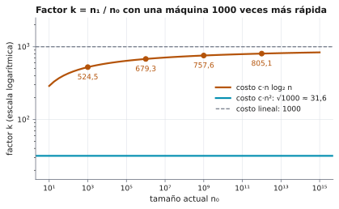

# Ejercicio 1. Una computadora mil veces más rápida

Dificultad: ★ · Código: [`ejercicio-01.py`](ejercicio-01.py)

---

## Enunciado

> Una computadora mil veces más rápida. ¿Cuánto crece el tamaño de entrada que se resuelve en una hora con un algoritmo $\Theta(n^2)$? ¿Y con uno $\Theta(n \log n)$? Estima los dos factores.

## Qué se pide

1. Calcular el factor $n_1/n_0$ por el que crece el mayor tamaño de entrada resoluble en una hora cuando la máquina hace 1000 veces más operaciones, si el algoritmo cuesta $\Theta(n^2)$.
2. Calcular el mismo factor si el algoritmo cuesta $\Theta(n \log n)$.
3. Interpretar la diferencia entre los dos resultados.

## Preliminares

**Costo en operaciones, no en segundos** (Conferencia 1, §2). Un algoritmo se mide contando operaciones en un modelo de cómputo. Una computadora más rápida hace más operaciones en el mismo tiempo, y esa es la única diferencia entre las dos máquinas del ejercicio.

**Notación.**

- $T$: número de operaciones que hace la computadora vieja en una hora.
- $1000\,T$: número de operaciones que hace la computadora nueva en una hora.
- $n_0$ y $n_1$: mayores tamaños de entrada que se resuelven en una hora en la computadora vieja y en la nueva, respectivamente.

**Fijar el costo exacto.** La notación $\Theta$ esconde una constante multiplicativa. Para poder estimar un factor se toma una constante $c > 0$ cualquiera, y se supone que el algoritmo cuesta exactamente $c\,n^2$ operaciones (primer caso) o $c\,n\log_2 n$ operaciones (segundo caso). Se verá que el factor resultante no depende de $c$.

**Tamaños reales.** El tamaño $n$ es un entero, así que casi nunca hay una entrada que gaste justo las $T$ operaciones disponibles: la mayor que cabe deja algunas sin usar. Las ecuaciones de abajo suponen lo contrario, que $n_0$ y $n_1$ son reales y que el costo llega exactamente a $T$ y a $1000\,T$. Eso permite dividir las ecuaciones y despejar el factor. El tamaño entero verdadero es el redondeo hacia abajo del que da la ecuación, y difiere de él en menos de $1$. Para tamaños grandes, menos de una unidad es una fracción mínima del valor (menos de $1/n_0$ en términos relativos), y el factor no cambia de forma apreciable.

**Ejemplo guiado (Conferencia 1, §7).** Con una computadora $1000$ veces más rápida, un algoritmo lineal resuelve entradas $1000$ veces más grandes, y uno cuadrático solo $\sqrt{1000} \approx 32$ veces más grandes. Este ejercicio demuestra esa afirmación y calcula el caso $n \log n$, que la conferencia no detalla.

---

## Algoritmo $\Theta(n^2)$

Primero el caso cuadrático, que es el más sencillo: las dos ecuaciones se dividen y se cancela todo menos el factor buscado.

**Proposición 1.** Si el costo es $c\,n^2$, entonces

$$\frac{n_1}{n_0} = \sqrt{1000} \approx 31{,}6,$$

para cualquier $c > 0$ y cualquier $n_0$.

**Demostración.**

**Paso 1.** La computadora vieja usa todas sus operaciones con la entrada de tamaño $n_0$:

$$c\,n_0^2 = T$$

**Paso 2.** La computadora nueva usa sus $1000\,T$ operaciones con la entrada de tamaño $n_1$:

$$c\,n_1^2 = 1000\,T$$

**Paso 3.** Se divide la ecuación del paso 2 entre la del paso 1. La constante $c$ y el valor $T$ se cancelan:

$$\frac{n_1^2}{n_0^2} = 1000$$

**Paso 4.** Como $n_0, n_1 > 0$, se extrae la raíz cuadrada:

$$\frac{n_1}{n_0} = \sqrt{1000} \approx 31{,}6. \qquad\blacksquare$$

**Ejemplo.** Sea $c = 1$: el algoritmo cuesta $n^2$ operaciones.

- *Máquina vieja:* $T = 10^6$ operaciones. Se resuelve $n_0^2 = 10^6$, luego $n_0 = 1000$.
- *Máquina nueva:* $1000\,T = 10^9$ operaciones. Se resuelve $n_1^2 = 10^9$, luego $n_1 \approx 31\,623$.
- *Factor:* $31\,623 / 1000 \approx 31{,}6$.

Una máquina $1000$ veces más rápida solo permite una entrada unas $32$ veces mayor.

**Observación sobre $\Theta$.** La notación $\Theta(n^2)$ no fija la constante: dos algoritmos con costos $n^2$ y $4n^2$ son ambos $\Theta(n^2)$. Con los mismos presupuestos ($10^6$ y $10^9$ operaciones):

| algoritmo | $n$ en la máquina vieja | $n$ en la máquina nueva | factor |
|---|---|---|---|
| A: costo $n^2$ | $1000$ | $31\,623$ | $31{,}6$ |
| B: costo $4n^2$ | $500$ | $15\,811$ | $31{,}6$ |

Cada algoritmo tiene su constante, la misma en las dos máquinas, y se cancela. Es la Proposición 1.

Lo que $\Theta$ no impide es que la constante cambie con el tamaño: basta que el costo $f(n)$ cumpla $c_1 n^2 \le f(n) \le c_2 n^2$. Entonces la máquina vieja puede caer en un tamaño favorable y la nueva en uno desfavorable, o al revés. Con las mismas ecuaciones aproximadas, $f(n_0) = T$ y $f(n_1) = 1000\,T$, se tiene

$$c_1 n_1^2 \le f(n_1) = 1000\,f(n_0) \le 1000\,c_2 n_0^2,$$

luego $n_1/n_0 \le \sqrt{1000\,c_2/c_1}$. Con el argumento simétrico, $n_1/n_0 \ge \sqrt{1000\,c_1/c_2}$.

**Ejemplo con $c_1 = 1$ y $c_2 = 4$.** El factor queda entre $\sqrt{1000/4} \approx 15{,}8$ y $\sqrt{4000} \approx 63{,}2$. Si la vieja cae en un tamaño con costo $n^2$ ($n_0 = 1000$) y la nueva en uno con costo $4n^2$, el factor es $15{,}8$. Si es al revés ($n_0 = 500$ con costo $4n^2$ y $n_1 = 31\,623$ con costo $n^2$), el factor es $63{,}2$.

**Conclusión.** Con solo $\Theta(n^2)$, el factor es $\sqrt{1000}$ multiplicado por una constante desconocida. El valor $31{,}6$ de la Proposición 1 corresponde a un costo exacto $c\,n^2$, que es la lectura natural de «estima el factor».

---

## Algoritmo $\Theta(n \log n)$

El planteamiento es el mismo que en el caso cuadrático, pero ahora el logaritmo impide despejar el factor directamente, y la ecuación resultante hay que estudiarla.

**Planteamiento.**

**Paso 1.** Ecuación de la computadora vieja:

$$c\,n_0 \log_2 n_0 = T$$

**Paso 2.** Ecuación de la computadora nueva:

$$c\,n_1 \log_2 n_1 = 1000\,T$$

**Paso 3.** Se divide la segunda entre la primera:

$$\frac{n_1 \log_2 n_1}{n_0 \log_2 n_0} = 1000$$

**Paso 4.** Se escribe $n_1 = k\,n_0$, donde $k = n_1/n_0$ es el factor buscado. Se sustituye y se simplifica $n_0$:

$$\frac{k\,\log_2 (k\,n_0)}{\log_2 n_0} = 1000$$

**Paso 5.** Se usa $\log_2(k\,n_0) = \log_2 k + \log_2 n_0$ y se reparte la división:

$$k\left(1 + \frac{\log_2 k}{\log_2 n_0}\right) = 1000 \tag{$\ast$}$$

**Proposición 2.** Para todo $n_0 \ge 2$, la ecuación $(\ast)$ tiene una única solución $k > 1$, y esta cumple

$$\frac{1000}{1 + \log_2(1000)/\log_2 n_0} \;<\; k \;<\; 1000.$$

En particular $k \to 1000$ cuando $n_0 \to \infty$.

**Demostración.**

**Existencia y unicidad.** La función $g(k) = k\bigl(1 + \log_2 k/\log_2 n_0\bigr)$ es continua y estrictamente creciente para $k \ge 1$, con $g(1) = 1 < 1000$ y $g(1000) > 1000$. Por el teorema del valor intermedio y la monotonía, existe una única solución en $(1, 1000)$.

**Cota superior.** Como $k > 1$, se tiene $\log_2 k > 0$, y por tanto

$$1 + \frac{\log_2 k}{\log_2 n_0} > 1 \quad\Longrightarrow\quad k = \frac{1000}{1 + \log_2 k/\log_2 n_0} < 1000.$$

**Cota inferior.** Como $k < 1000$ y el logaritmo es creciente, $\log_2 k < \log_2 1000 \approx 9{,}97$. Al reemplazar $\log_2 k$ por esa cota en $(\ast)$, el lado izquierdo solo puede agrandarse:

$$1000 = k\left(1 + \frac{\log_2 k}{\log_2 n_0}\right) < k\left(1 + \frac{\log_2 1000}{\log_2 n_0}\right)$$

Despejando $k$ se obtiene la cota inferior.

**Límite.** Cuando $n_0 \to \infty$, el cociente $\log_2(1000)/\log_2 n_0$ tiende a $0$, la cota inferior tiende a $1000$, y por tanto $k \to 1000$. $\blacksquare$

**Valores concretos** (resolviendo $(\ast)$ por bisección):

| $n_0$ | $k$ | cota inferior |
|---|---|---|
| $10^3$ | 524,5 | 500,0 |
| $10^6$ | 679,3 | 666,7 |
| $10^9$ | 757,6 | 750,0 |
| $10^{12}$ | 805,1 | 800,0 |

<picture>
  <source media="(prefers-color-scheme: dark)" srcset="figuras/ejercicio-01-factor-oscuro.svg">
  
</picture>

**Figura 1.** El factor $k$ para $n_0$ entre $10$ y $10^{15}$, con el eje vertical en escala logarítmica. Para $c\,n\log_2 n$ crece despacio hacia $1000$ sin alcanzarlo, y los puntos marcados son los de la tabla. Para $c\,n^2$ es la constante $\sqrt{1000} \approx 31{,}6$.

**Comprobación con $n_0 = 10^6$.** Con $k = 679{,}3$: $\log_2 k = 9{,}41$ y $\log_2 n_0 = 19{,}93$, así que $679{,}3\cdot(1 + 9{,}41/19{,}93) \approx 679{,}3 \cdot 1{,}472 \approx 1000$.

---

## Verificación con código

El archivo [`ejercicio-01.py`](ejercicio-01.py) calcula los factores de dos maneras: directamente (búsqueda binaria del mayor $n$ con costo dentro del presupuesto, con $c = 1$) y resolviendo la ecuación $(\ast)$. Resultados:

```
Algoritmo c*n^2 (c = 1)
        n0     n1 directo    n1/n0  sqrt(1000)
     1e+03         31,622    31.62       31.62
     1e+06     31,622,776    31.62       31.62
     1e+09 31,622,776,601    31.62       31.62

Algoritmo c*n*log2(n) (c = 1)
      n0  k directo  k (ecuación)  cota inf.
   1e+03      524.5         524.5      500.0
   1e+06      679.3         679.3      666.7
   1e+09      757.6         757.6      750.0
   1e+12      805.1         805.1      800.0
```

El cálculo directo y la ecuación coinciden, y en el caso cuadrático el factor es el mismo para los tres valores de $n_0$. Como contraste, la tabla de la Conferencia 1, §7, da para $n \log n$ el paso de $9{,}86\cdot 10^{10}$ a $7{,}8\cdot 10^{13}$ (factor $\approx 790$), consistente con la Proposición 2 para ese $n_0$.

## Resumen de resultados

| Algoritmo | Factor de crecimiento de la entrada |
|---|---|
| $\Theta(n^2)$ | $\sqrt{1000} \approx 32$, para cualquier $n_0$ |
| $\Theta(n \log n)$ | $k$ con $k\bigl(1 + \log_2 k/\log_2 n_0\bigr) = 1000$; cumple $k < 1000$ y $k \to 1000$ al crecer $n_0$. Por ejemplo, $k \approx 680$ si $n_0 = 10^6$ |

**Conclusión.** Con un algoritmo cuadrático, una máquina $1000$ veces más rápida solo permite multiplicar la entrada por unas $32$ veces. Con $n\log n$, por varios cientos: de $524$ a $805$ en la tabla de la sección sobre el algoritmo $\Theta(n \log n)$, y tiende a $1000$ cuando $n_0$ crece. Mejorar el algoritmo vale más que mejorar la máquina, y por eso en el curso se mide el costo de forma asintótica y no en segundos (Conferencia 1, §2 y §7).

## Referencias

- Conferencia 1, §2: medir en segundos no sirve; se cuentan operaciones en un modelo.
- Conferencia 1, §5: notación asintótica ($\Theta$ oculta una constante).
- Conferencia 1, §7: por qué la complejidad importa más cuando la computadora mejora.
