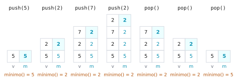

# Ejercicio 3. Una pila con `mínimo` en $O(1)$

Dificultad: ★ · Código: [`ejercicio-03.py`](ejercicio-03.py)

---

## Enunciado

> Una pila con una operación `mínimo` que cuesta $O(1)$ en el peor caso. Diseña la estructura, enuncia el invariante que la hace correcta y da el costo de cada operación.

## Qué se pide

1. Diseñar una pila con `push`, `pop` y `minimo`, donde `minimo` cueste $O(1)$ **en el peor caso** (no amortizado).
2. Enunciar y demostrar un invariante que garantice su correctitud (Conferencia 3, §1).
3. Dar el costo de cada operación.

## Preliminares

**Operaciones.** La pila guarda elementos de un orden total.

- `push(x)`: agrega $x$ en el tope.
- `pop()`: quita y devuelve el tope. Precondición: la pila no está vacía.
- `minimo()`: devuelve el menor elemento de la pila. Precondición: la pila no está vacía.

**Modelo.** Se supone que `append` y `pop` sobre una lista cuestan $O(1)$ en el peor caso, y que comparar dos elementos cuesta $O(1)$. Eso vale para un arreglo con capacidad reservada de antemano (si se conoce el tamaño máximo de la pila) o para una lista enlazada. Con las listas de Python, `append` cuesta $O(1)$ solo amortizado, porque de vez en cuando copia el arreglo a uno más grande.

**Por qué no basta una pila sencilla.** Con una pila ordinaria, `minimo` obliga a recorrer los $n$ elementos: $\Theta(n)$. Guardar un único «mínimo actual» tampoco sirve: tras un `pop` del mínimo, no se sabe cuál es el siguiente sin recorrer la pila. La solución es guardar la información necesaria **para cada estado de la pila**.

**Correctitud mediante invariante** (Conferencia 3, §1). Se prueba: (i) inicialización, el invariante vale al crear la estructura; (ii) mantenimiento, cada operación lo conserva; (iii) conclusión, el invariante implica que la respuesta es correcta.

---

## La estructura

**La idea.** Cada vez que se agrega un elemento, se anota al lado cuál es el mínimo de todo lo que hay hasta ese momento. Así, cuando se quita el tope, el mínimo anterior ya estaba anotado y no hay que recalcularlo. Por ejemplo, con los valores $5, 2, 7$ las anotaciones son $5, 2, 2$: el $7$ no cambia el mínimo, y si se quita el $7$ el mínimo sigue siendo $2$.

Se usan **dos pilas paralelas**:

- `v`: los valores.
- `m`: en la posición $i$, el mínimo de `v[0], ..., v[i]`.

```python
class PilaMin:
    def __init__(self):
        self.v = []      # valores
        self.m = []      # m[i] = mínimo de v[0..i]

    def push(self, x):
        self.v.append(x)
        self.m.append(x if not self.m else min(x, self.m[-1]))

    def pop(self):
        self.m.pop()
        return self.v.pop()

    def minimo(self):
        return self.m[-1]
```

**Ejemplo.** Tras `push(5)`, `push(2)`, `push(7)`, `push(2)`:

| posición | `v` | `m` |
|---|---|---|
| 0 | 5 | 5 |
| 1 | 2 | 2 |
| 2 | 7 | 2 |
| 3 | 2 | 2 |

`minimo()` lee el tope de `m` y devuelve $2$. Tras tres `pop` queda `v = [5]`, `m = [5]` y `minimo()` devuelve $5$ sin recorrer nada.

<picture>
  <source media="(prefers-color-scheme: dark)" srcset="figuras/ejercicio-03-pilas-oscuro.svg">
  
</picture>

**Figura 1.** Las pilas `v` y `m` después de cada operación del ejemplo. El tope de `m` (sombreado) es siempre el mínimo de `v`, y `minimo()` solo lo lee.

---

## El invariante

El ejemplo anterior funciona porque `m` siempre guarda el mínimo hasta cada posición. Eso es exactamente lo que el invariante afirma, y lo que hay que demostrar que cada operación conserva.

**Invariante (I).** Cuando no se está ejecutando ninguna operación, las pilas `v` y `m` tienen el mismo largo $L$, y para todo $0 \le i < L$:

$$m[i] = \min\{\,v[0], v[1], \dots, v[i]\,\}.$$

## Correctitud

Se sigue el esquema de las Preliminares: el invariante vale al crear la pila, lo conservan `push` y `pop`, y de él se deduce que `minimo()` es correcto.

**Teorema 1.** (I) se cumple en todo momento, y `minimo()` devuelve el mínimo de la pila.

**Demostración.**

**Inicialización.**

**Paso 1.** Al crear la estructura, `v` y `m` están vacías: ambas tienen largo $L = 0$.

**Paso 2.** No existe $i$ con $0 \le i < 0$, así que la condición sobre $m[i]$ se cumple por vacuidad. (I) vale.

**Mantenimiento de `push(x)`.** Se supone (I) antes del `push`, con largo $L$.

**Paso 1.** `push(x)` agrega un elemento a cada pila. Los largos pasan a ser $L+1$ los dos.

**Paso 2.** Las posiciones $i < L$ no cambian ni en `v` ni en `m`; para ellas (I) sigue valiendo.

**Paso 3.** Falta la nueva posición $L$: hay que ver que $m[L] = \min\{v[0], \dots, v[L]\}$.

- **Caso $L = 0$.** El código escribe $m[0] = x$, y $\min\{v[0]\} = \min\{x\} = x$.
- **Caso $L \ge 1$.** El código escribe $m[L] = \min(x, m[L-1])$. Por (I) antes del `push`, $m[L-1] = \min\{v[0], \dots, v[L-1]\}$. Entonces

$$m[L] = \min\bigl(x,\ \min\{v[0], \dots, v[L-1]\}\bigr) = \min\{v[0], \dots, v[L-1], x\} = \min\{v[0], \dots, v[L]\}.$$

**Mantenimiento de `pop()`.**

**Paso 1.** `pop()` quita el último elemento de cada pila; los largos pasan a ser $L-1$ los dos.

**Paso 2.** Las posiciones $i < L-1$ no cambian, así que (I) sigue valiendo para ellas.

**Mantenimiento de `minimo()`.** No modifica nada.

**Conclusión.**

**Paso 1.** Si $L \ge 1$, `minimo()` devuelve $m[L-1]$.

**Paso 2.** Por (I) con $i = L-1$:

$$m[L-1] = \min\{v[0], \dots, v[L-1]\},$$

que es el mínimo de **toda** la pila. $\blacksquare$

**Ejemplo.** Con $v = [5, 2, 7, 2]$ y $m = [5, 2, 2, 2]$: `minimo()` devuelve $m[3] = 2 = \min\{5, 2, 7, 2\}$. Tras un `pop`: $v = [5, 2, 7]$, $m = [5, 2, 2]$ y `minimo()` devuelve $2 = \min\{5, 2, 7\}$.

---

## Costo

Con la estructura y su correctitud probadas, falta contar cuánto cuesta cada operación.

| Operación | Qué hace | Peor caso |
|---|---|---|
| `push(x)` | una comparación y dos `append` | $O(1)$ |
| `pop()` | dos `pop` | $O(1)$ |
| `minimo()` | una lectura | $O(1)$ |

Ninguna operación tiene ciclos ni recorre la pila: hace una cantidad fija de pasos independiente de $n$. Por eso, con pilas de costo $O(1)$ en el peor caso (ver «Modelo» en Preliminares), cada operación cuesta $O(1)$ **en el peor caso**, no solo amortizado. La memoria es $O(n)$, porque `m` tiene el largo de `v`.

---

## Una variante que ahorra memoria, y por qué necesita `≤`

¿Hace falta guardar un mínimo por cada elemento? Una variante común guarda en `m` solo los mínimos **nuevos**: al apilar $x$ lo copia en `m` si $x$ es menor o igual que el tope de `m`, y al desapilar quita el tope de `m` si coincide con el valor que sale. Así `m` puede ser mucho más corta que `v`; por ejemplo, si los valores llegan en orden creciente, `m` tiene un solo elemento.

```python
def push(self, x):
    self.v.append(x)
    if not self.m or x <= self.m[-1]:     # con «<» falla
        self.m.append(x)

def pop(self):
    x = self.v.pop()
    if x == self.m[-1]:
        self.m.pop()
    return x
```

**Con `<` en lugar de `≤` falla cuando el mínimo se repite.** Con `push(2)`, `push(2)`, `pop()`: el segundo $2$ no entra en `m`, porque no es menor que el tope. El `pop` saca un $2$ de `v`, ve que coincide con el tope de `m` y lo quita. Quedan `v = [2]` y `m` vacía, y `minimo()` ya no tiene respuesta. Cada copia del mínimo en `v` necesita su propia copia en `m`, para que cada `pop` que la quite tenga una que quitar.

**Qué ven las pruebas** (salida de [`ejercicio-03.py`](ejercicio-03.py)). Entre las $59\,235$ secuencias válidas de hasta $8$ operaciones con los valores $0$, $1$ y $2$, la versión con `<` falla en $19\,959$ y la versión con `≤` en ninguna (es una comprobación exhaustiva para ese tamaño, no una demostración). Cada falla de la versión con `<` tiene un `push` de un valor igual al mínimo del momento. Con secuencias aleatorias de $20$ operaciones, lo que decide si el error aparece es cuántos valores distintos usa el generador:

| valores | secuencias en que falla la versión con `<` |
|---|---|
| $0$ a $1$ | $95{,}4\,\%$ |
| $0$ a $9$ | $41{,}6\,\%$ |
| $0$ a $999$ | $0{,}4\,\%$ |
| $0$ a $10^6$ | $0{,}0\,\%$ |

Un generador con valores de un rango grande casi nunca repite el mínimo y no ve el error. Es la lección de la Conferencia 3, §5: las pruebas solo cubren los casos que el generador produce, y aquí el caso que importa es el empate.

---

## Verificación con código

El archivo [`ejercicio-03.py`](ejercicio-03.py) comprueba el invariante después de cada operación en secuencias aleatorias, y cuenta las operaciones elementales de `minimo()`:

```
v = [5, 2, 7, 2]  m = [5, 2, 2, 2]  minimo() = 2
tras tres pop: v = [5]  m = [5]  minimo() = 5
operaciones comprobadas: 40582, respuestas incorrectas de minimo(): 0
n =      10: minimo() cuesta 1 operación elemental
n =    1000: minimo() cuesta 1 operación elemental
n =  100000: minimo() cuesta 1 operación elemental
```

Se comprobaron 40 582 operaciones sin ninguna respuesta incorrecta, y `minimo()` cuesta una operación sin importar el tamaño de la pila.

## Resumen de resultados

1. **Estructura:** dos pilas paralelas, `v` (valores) y `m` (mínimo hasta cada posición).
2. **Invariante:** mismo largo y $m[i] = \min\{v[0], \dots, v[i]\}$.
3. **Correctitud:** `push` usa $\min(x, m[L-1])$, `pop` quita el tope de ambas, y el tope de `m` es el mínimo de toda la pila.
4. **Costo:** `push`, `pop` y `minimo` en $O(1)$ en el peor caso; memoria $O(n)$.
5. **Variante compacta:** guardar solo los mínimos nuevos exige `≤`; con `<` falla cuando el mínimo se repite, y un generador con valores de rango grande casi nunca lo detecta.

## Referencias

- Conferencia 3, §1: correctitud por invariante (inicialización, mantenimiento, conclusión).
