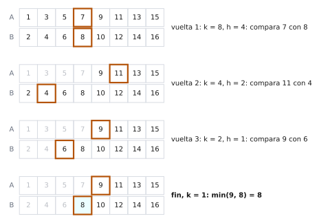

# Ejercicio 7. Mediana de dos arreglos ordenados

Dificultad: ★★★ · Código: [`ejercicio-07.py`](ejercicio-07.py)

---

## Enunciado

> Mediana de dos arreglos ordenados de largo $n$: el $n$-ésimo menor de los $2n$ elementos. Diseña un algoritmo $O(\log n)$, demuestra su correctitud y da la cota de información.

## Qué se pide

1. Diseñar un algoritmo que halle la mediana de $A \cup B$ con $O(\log n)$ comparaciones.
2. Demostrar su correctitud (invariante) y su terminación y costo (potencial).
3. Demostrar la cota de información: ningún algoritmo de comparaciones lo hace con menos comparaciones.

**Mapa.** Una sola comparación entre un elemento de $A$ y uno de $B$, bien elegidos, permite descartar muchos elementos que seguro no son la mediana, como hace la búsqueda binaria con la mitad del rango. Para poder repetir esa idea hay que generalizar el problema, de «la mediana» a «el $k$-ésimo menor». Con eso se escribe el algoritmo, se prueba con un invariante que descarta solo elementos que sobran, se cuenta su costo con un potencial y, al final, se prueba que ningún algoritmo de comparaciones lo mejora.

## Preliminares

**Datos.** $A$ y $B$ son arreglos crecientes de $n$ elementos, y los $2n$ elementos son **distintos entre sí**. (Si hubiera repetidos, se desempata por $(\text{valor}, \text{arreglo}, \text{posición})$ y todo lo que sigue vale igual.) La **mediana** es el $n$-ésimo menor de los $2n$ elementos.

**Modelo de comparaciones** (Conferencia 5, §1). Solo se accede a los datos comparando un elemento de $A$ con uno de $B$; cada comparación tiene dos respuestas ($<$ o $>$). El costo es el número de comparaciones. Comparar dos elementos del mismo arreglo no aporta nada: su orden ya se conoce.

**Notación.** $A[a:]$ es el trozo $A[a], A[a+1], \dots, A[n-1]$ (índices desde $0$).

**Ejemplo** ($n = 4$):

```
A = [1, 4, 7, 10]
B = [2, 3, 8, 9]
```

Los 8 elementos ordenados son $1, 2, 3, 4, 7, 8, 9, 10$; el 4.º menor es $4$, así que la mediana es $4$.

---

## La idea: el problema general del $k$-ésimo menor

Para poder repetir la idea se resuelve un problema más general: el **$k$-ésimo menor** de la unión de dos arreglos ordenados. La mediana es el caso $k = n$. Tras descartar elementos que seguro son menores que el buscado, lo que se busca pasa a ser el $k'$-ésimo menor de lo que queda, con $k' < k$.

**Idea.** Se comparan los elementos de la posición $h = \lfloor k/2 \rfloor$ de cada arreglo vivo. Con una comparación se descartan $h$ elementos que seguro son menores que el buscado.

**Ejemplo con $k = 4$, $h = 2$.** Se comparan $A[1] = 4$ y $B[1] = 3$. Como $3 < 4$, se descartan $B[0] = 2$ y $B[1] = 3$: el $3$ tiene a lo sumo un menor en $B$ (el $2$) y a lo sumo uno en $A$ (el $1$), así que es a lo sumo el 3.º menor, y el $2$ queda antes. Se busca ahora el $4 - 2 = 2$.º menor de lo que queda.

---

## El algoritmo

Con la idea del $k$-ésimo menor ya se puede escribir el código. Cada vuelta compara las posiciones $h = \lfloor k/2 \rfloor$ de lo que queda de $A$ y de $B$, descarta $h$ elementos del arreglo con el valor menor y reduce $k$ en $h$. Cuando $k = 1$, el buscado es el menor de los dos primeros elementos vivos.

```python
def mediana(A, B):                    # A y B ordenados, largo n, elementos distintos
    n = len(A)
    # vivos: A[ia:] y B[ib:]; se busca el k-ésimo menor de lo vivo
    ia, ib, k = 0, 0, n
    while k > 1:
        h = k // 2
        if A[ia + h - 1] < B[ib + h - 1]:
            ia += h                   # se descartan A[ia], ..., A[ia+h-1]
        else:
            ib += h                   # se descartan B[ib], ..., B[ib+h-1]
        k -= h
    return min(A[ia], B[ib])
```

**Traza con el ejemplo ($n = 4$).**

| vuelta | `ia` | `ib` | `k` | `h` | comparación | efecto |
|---|---|---|---|---|---|---|
| 1 | 0 | 0 | 4 | 2 | $A[1] = 4$ contra $B[1] = 3$: $4 > 3$ | `ib = 2`, `k = 2` |
| 2 | 0 | 2 | 2 | 1 | $A[0] = 1$ contra $B[2] = 8$: $1 < 8$ | `ia = 1`, `k = 1` |
| fin | 1 | 2 | 1 | | $\min(A[1], B[2]) = \min(4, 8)$ | devuelve **4** |

Son $3$ comparaciones.

**Traza con $n = 8$**, $A = [1,3,5,7,9,11,13,15]$ y $B = [2,4,6,8,10,12,14,16]$ (la mediana es el 8.º menor, $8$):

| vuelta | `ia` | `ib` | `k` | `h` | comparación | efecto |
|---|---|---|---|---|---|---|
| 1 | 0 | 0 | 8 | 4 | $A[3] = 7$ contra $B[3] = 8$: $7 < 8$ | `ia = 4`, `k = 4` |
| 2 | 4 | 0 | 4 | 2 | $A[5] = 11$ contra $B[1] = 4$: $11 > 4$ | `ib = 2`, `k = 2` |
| 3 | 4 | 2 | 2 | 1 | $A[4] = 9$ contra $B[2] = 6$: $9 > 6$ | `ib = 3`, `k = 1` |
| fin | 4 | 3 | 1 | | $\min(A[4], B[3]) = \min(9, 8)$ | devuelve **8** |

Son $4$ comparaciones.

<picture>
  <source media="(prefers-color-scheme: dark)" srcset="figuras/ejercicio-07-corte-oscuro.svg">
  
</picture>

**Figura 1.** La traza con $n = 8$. En cada vuelta se recuadran los dos elementos comparados, y los descartados quedan en gris: se descartan los $h$ primeros vivos del arreglo con el valor menor. Al final la mediana es $\min(9, 8) = 8$ (sombreada).

---

## Correctitud con un invariante

Las trazas muestran que el algoritmo acierta en dos ejemplos. Para probar que acierta siempre hay que ver que cada descarte es seguro: nunca se tira el elemento buscado. El invariante expresa eso diciendo que, después de descartar, el buscado sigue siendo el $k$-ésimo menor de lo que queda.

**Invariante.** Al comenzar cada vuelta del `while` y al salir de él:

$$\text{(I1)}\quad ia + ib = n - k, \qquad ia \ge 0,\ ib \ge 0,\ k \ge 1,$$

$$\text{(I2)}\quad \text{el } n\text{-ésimo menor de } A \cup B \text{ es el } k\text{-ésimo menor de } A[ia:] \cup B[ib:].$$

**Lema 1 (índices válidos).** Si vale (I1), cada arreglo vivo tiene al menos $k$ elementos. En particular las posiciones $ia + h - 1$ y $ib + h - 1$ están dentro de los arreglos, pues $h \le k$.

**Demostración.** De (I1), $ia + ib = n - k$, luego

$$n - ia = k + ib \ge k, \qquad n - ib = k + ia \ge k. \qquad\blacksquare$$

**Teorema 1.** (I1) e (I2) valen al empezar cada vuelta y al salir del ciclo, y el algoritmo devuelve la mediana.

**Demostración.**

**Inicialización.**

**Paso 1.** Antes de la primera vuelta, $ia = ib = 0$ y $k = n$.

**Paso 2.** (I1): $0 + 0 = n - n$.

**Paso 3.** (I2): $A[0:] \cup B[0:]$ es todo, y el $k$-ésimo con $k = n$ es el $n$-ésimo menor.

**Mantenimiento.** Se supone (I1) e (I2) al empezar una vuelta con $k \ge 2$. Sean

$$h = \lfloor k/2 \rfloor, \qquad u = A[ia + h - 1], \qquad v = B[ib + h - 1].$$

Como $k \ge 2$, se tiene $h \ge 1$ y $2h \le k$. Como los elementos son distintos, $u \ne v$.

**Caso 1: $u < v$.** El algoritmo hace `ia += h` y `k -= h`.

**Paso 1.** Los elementos vivos de $A$ menores que $u$ son exactamente los $h-1$ que van antes que $u$ en $A[ia:]$.

**Paso 2.** Todo elemento vivo de $B$ que sea $\ge v$ es mayor que $u$ (porque $v > u$). Entonces los elementos vivos de $B$ menores que $u$ están entre los $h-1$ que van antes que $v$: son **a lo sumo $h-1$**.

**Paso 3.** El número de elementos vivos menores que $u$ es a lo sumo $(h-1) + (h-1) = 2h - 2$. Por tanto $u$ ocupa en lo vivo un lugar $\le 2h - 1 \le k - 1$.

**Paso 4.** Los $h$ elementos $A[ia], \dots, A[ia+h-1]$ son todos $\le u$, así que ocupan lugares $\le k-1$: ninguno es el $k$-ésimo menor. Son $h$ elementos **menores que el buscado**.

**Paso 5.** Al quitar $h$ elementos menores que el buscado, este pasa del lugar $k$ al lugar $k - h$ de lo que queda: es el $(k-h)$-ésimo menor de $A[ia+h:] \cup B[ib:]$. Es (I2) con los nuevos valores.

**Paso 6.** (I1): $(ia + h) + ib = (n - k) + h = n - (k - h)$, y $k - h \ge 1$.

**Caso 2: $u > v$.** Es simétrico, intercambiando $A$ y $B$: los elementos vivos de $A$ menores que $v$ están entre los $h-1$ anteriores a $u$, $v$ ocupa un lugar $\le 2h-1 \le k-1$, y se descartan $B[ib], \dots, B[ib+h-1]$ con `ib += h`.

**Conclusión.**

**Paso 1.** El ciclo termina con $k = 1$ (la terminación se demuestra en «Terminación y costo»).

**Paso 2.** Por (I2), la mediana es el 1.er menor de $A[ia:] \cup B[ib:]$.

**Paso 3.** Por (I1) con $k = 1$, ambos arreglos vivos tienen al menos un elemento.

**Paso 4.** El menor de la unión de dos arreglos ordenados es el menor de sus dos primeros elementos, $\min(A[ia], B[ib])$, que es lo que devuelve el algoritmo. $\blacksquare$

---

## Terminación y costo

La correctitud supone que el ciclo termina y que los índices están dentro de los arreglos. Esta sección prueba la terminación y cuenta las comparaciones. Como en cada vuelta $k$ pasa a ser la mitad (redondeada hacia arriba), el potencial natural es el propio $k$.

**Potencial.** $\Phi = k$.

**Teorema 2.** El algoritmo termina y hace exactamente $\lceil \log_2 n \rceil + 1$ comparaciones.

**Demostración.**

**Paso 1.** $\Phi$ es entero y, por (I1), $k \ge 1$ siempre.

**Paso 2.** En cada vuelta $k$ pasa a ser $k - \lfloor k/2 \rfloor = \lceil k/2 \rceil$. Como $h \ge 1$, baja estrictamente. Un entero $\ge 1$ que baja estrictamente no puede bajar indefinidamente: el ciclo termina.

**Paso 3.** Con $k_0 = n$ y $k \mapsto \lceil k/2 \rceil$, después de $t$ vueltas $k_t = \lceil n/2^t \rceil$.

**Paso 4.** $k_t = 1$ cuando $2^t \ge n$; el primer $t$ así es $\lceil \log_2 n \rceil$.

**Paso 5.** Cada vuelta hace una comparación entre un elemento de $A$ y uno de $B$, y el `min` final es una más. Total, **siempre** (no solo en el peor caso):

$$\lceil \log_2 n \rceil + 1 = O(\log n). \qquad\blacksquare$$

**Comprobación.** $n = 4$: $2 + 1 = 3$; $n = 8$: $3 + 1 = 4$. Coincide con las trazas.

---

## La cota de información

El algoritmo hace $\lceil \log_2 n \rceil + 1$ comparaciones. Falta ver si otro algoritmo podría hacer menos. Se responde contando cuántas salidas distintas debe poder dar cualquier algoritmo: si hay $2n$ medianas posibles, el árbol de decisión necesita $2n$ hojas.

**Teorema 3.** Todo algoritmo de comparaciones que halle la mediana de $A \cup B$ hace al menos $\lceil \log_2 n \rceil + 1$ comparaciones en el peor caso.

**El árbol de decisión** (Conferencia 5, §2). Cada nodo interno compara un elemento de $A$ con uno de $B$ y tiene dos ramas ($<$, $>$). Cada hoja es una salida: la posición del elemento declarado mediana (por ejemplo «$A[2]$»). El costo en el peor caso es la altura.

**Lema 2.** Para cada uno de los $2n$ elementos existe una entrada válida en la que ese elemento es la mediana.

**Demostración.**

**Paso 1.** Se toma $A[i]$, $0 \le i \le n-1$: hay $i$ elementos de $A$ menores que él.

**Paso 2.** Para que sea el $n$-ésimo menor hacen falta $n - 1 - i$ elementos de $B$ menores que él; ese número está entre $0$ y $n-1$, así que se puede lograr.

**Paso 3.** Se ponen $n-1-i$ elementos de $B$ por debajo de todo $A$ y los $i+1$ restantes por encima. Los elementos menores que $A[i]$ son $i + (n-1-i) = n-1$, y $A[i]$ es el $n$-ésimo menor. Para $B[j]$ es simétrico. $\blacksquare$

**Ejemplo** ($n = 4$). Para que $A[1] = 20$ sea la mediana con $A = [10, 20, 30, 40]$ hacen falta $4 - 1 - 1 = 2$ elementos de $B$ por debajo: $B = [1, 2, 50, 60]$. Los 8 ordenados son $1, 2, 10, 20, 30, 40, 50, 60$ y el 4.º es $20$.

**Demostración del Teorema 3.**

**Paso 1.** Por el Lema 2, hay $2n$ entradas con la mediana en posiciones distintas; un algoritmo correcto debe dar $2n$ salidas distintas.

**Paso 2.** El algoritmo solo ve el resultado de las comparaciones, así que la salida queda determinada por la hoja a la que llega. Salidas distintas implican hojas distintas: el árbol tiene al menos $2n$ hojas.

**Paso 3.** Un árbol binario de altura $h$ tiene a lo sumo $2^h$ hojas (Conferencia 5, Lema 1). Entonces $2^h \ge 2n$.

**Paso 4.** Tomando $\log_2$: $h \ge 1 + \log_2 n$. Como la altura es entera,

$$h \ge \lceil \log_2 n \rceil + 1. \qquad\blacksquare$$

**Conclusión: el algoritmo es óptimo.**

| | Comparaciones |
|---|---|
| Cota mínima (cualquier algoritmo de comparaciones) | $\lceil \log_2 n \rceil + 1$ |
| Algoritmo de este ejercicio | $\lceil \log_2 n \rceil + 1$ |

Coinciden exactamente: el problema cuesta $\Theta(\log n)$. Con $n = 4$ hay $8$ medianas posibles; la cota es $\log_2 8 = 3$ y el algoritmo hace $3$.

---

## Verificación con código

El archivo [`ejercicio-07.py`](ejercicio-07.py) cuenta las comparaciones sobre entradas aleatorias de distintos tamaños (comprobando la respuesta contra la ordenación completa) y, para $n = 4$, enumera las entradas para ver cuántas posiciones distintas puede ocupar la mediana:

```
n = 4: (4, 3)
n = 8: (8, 4)

    n  entradas   comparaciones (mín–máx)  ceil(log2 n)+1
    1       400             1 – 1                       1
    2       400             2 – 2                       2
    3       400             3 – 3                       3
    4       400             3 – 3                       3
    5       400             4 – 4                       4
    8       400             4 – 4                       4
   13       400             5 – 5                       5
   16       400             5 – 5                       5
  100       400             8 – 8                       8
 1000        40            11 – 11                     11

Cota de información: cada uno de los 2n elementos puede ser la mediana.
n = 4: posiciones distintas de la mediana observadas = 8 (2n = 8)
```

El número de comparaciones es exactamente $\lceil \log_2 n \rceil + 1$ en todas las entradas (mínimo y máximo coinciden), y para $n = 4$ se observan las $8 = 2n$ posiciones posibles de la mediana.

## Resumen de resultados

1. **Idea:** resolver el $k$-ésimo menor; comparar las posiciones $h = \lfloor k/2 \rfloor$ descarta $h$ elementos que seguro son menores que el buscado.
2. **Invariante:** $ia + ib = n - k$ y el $n$-ésimo menor del total es el $k$-ésimo menor de lo vivo.
3. **Costo:** $k \mapsto \lceil k/2 \rceil$; exactamente $\lceil \log_2 n \rceil + 1$ comparaciones.
4. **Cota de información:** $2n$ medianas posibles, $2n$ hojas, altura $\ge \lceil \log_2 n \rceil + 1$. Coincide con el algoritmo: es óptimo.

## Referencias

- Conferencia 2: descartar una fracción segura de la entrada en cada paso.
- Conferencia 3, §1: invariante y potencial.
- Conferencia 5, §1–§3: modelo de comparaciones, árboles de decisión y Lema 1 (hojas de un árbol binario).
