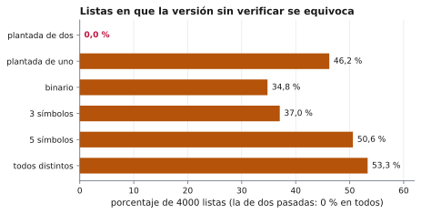

# Ejercicio 8. El elemento que aparece más de $n/3$ veces

Dificultad: ★★ · Código: [`ejercicio-08.py`](ejercicio-08.py)

---

## Enunciado

> El elemento que aparece más de $n/3$ veces. Generaliza Boyer–Moore con dos candidatos, enuncia el invariante reforzado y demuéstralo. Después escribe la versión que devuelve los candidatos con contador positivo sin verificarlos, y busca un generador de pruebas que no la atrape. Cuidado: el análogo del generador binario de la conferencia 3 sí la atrapa.

## Qué se pide

1. Generalizar Boyer–Moore a dos candidatos y dos contadores.
2. Enunciar y demostrar el **invariante reforzado** y, con él, el teorema «si $x$ aparece más de $n/3$ veces, es candidato».
3. Escribir la versión **sin verificar** (devuelve los candidatos con contador positivo) y mostrar que es incorrecta.
4. Buscar un generador de pruebas que **no** la atrape, y explicar por qué el análogo binario sí.

## Preliminares

**Datos.** La lista $L$ tiene $n$ elementos que solo se comparan por igualdad (no hay orden). Se buscan **todos** los $x$ con $3\cdot\text{cuenta}(x) > n$. Se quiere tiempo $O(n)$ y memoria extra $O(1)$.

**Ejemplo.** Con $L = [1,2,1,2,3,1,2]$: $n = 7$, $n/3 \approx 2{,}33$; el $1$ y el $2$ aparecen $3$ veces, luego las respuestas son $\{1, 2\}$.

**A lo sumo hay dos respuestas.** Tres elementos distintos con más de $n/3$ copias cada uno sumarían más de $n$ elementos.

**Boyer–Moore, el caso de la mayoría** (Conferencia 3, §3–§4). Se cancelan *parejas* de elementos distintos; el invariante reforzado dice que el prefijo se parte en parejas de distintos más $c$ copias del candidato. La conferencia explica por qué el invariante ingenuo («si el prefijo tiene mayoría, el candidato es esa mayoría») no es inductivo y hay que reforzarlo. Aquí se hace lo mismo con **tríos**.

**Dos palabras que se usan al final.** Un **oráculo** es una versión que sin duda es correcta, aunque sea lenta o gaste memoria (aquí, contar todos los elementos con un diccionario). Sirve de referencia: una versión del algoritmo se considera correcta en una lista si da la misma respuesta que el oráculo. Un **generador de pruebas** es un programa que produce listas de entrada, normalmente al azar, para comparar cada versión con el oráculo. La pregunta del final del ejercicio es si existe un generador cuyas listas nunca hagan fallar a la versión incorrecta, y por qué.

**Mapa.** Primero el algoritmo y su invariante reforzado, con los que se prueba que ninguna respuesta se pierde. Después, la versión que se salta la segunda pasada, que devuelve de más. Por último, qué generadores de pruebas la detectan y cuál no.

**La idea con un ejemplo.** En $L = [1,2,3,1,1]$ se puede cancelar el trío $(1,2,3)$ y quedan $[1,1]$. El $1$ aparece $3$ veces de $5$ y sobrevive a la cancelación, porque el trío le quitó solo una copia. Esa es la idea general.

**Idea.** Se cancelan *tríos* de tres elementos distintos entre sí. Un elemento con más de $n/3$ copias no puede cancelarse del todo: cada trío contiene a lo sumo una copia suya y hay a lo sumo $n/3$ tríos.

---

## El algoritmo

El algoritmo lee la lista una vez y guarda dos candidatos con un contador cada uno. Cuando llega un elemento distinto de ambos y los dos contadores son positivos, forma un trío con él y los dos candidatos, y lo descarta restando 1 a cada contador.

```python
def candidatos(L):
    c1 = c2 = None
    k1 = k2 = 0
    for x in L:
        if x == c1:      k1 += 1                 # otra copia suelta de c1
        elif x == c2:    k2 += 1                 # otra copia suelta de c2
        elif k1 == 0:    c1, k1 = x, 1           # el lugar 1 está libre
        elif k2 == 0:    c2, k2 = x, 1           # el lugar 2 está libre
        else:            k1 -= 1; k2 -= 1        # x, c1, c2 distintos: se cancela el trío
    return (c1, k1), (c2, k2)

def mayor_que_un_tercio(L):
    n = len(L)
    (c1, k1), (c2, k2) = candidatos(L)                  # 1.ª pasada: cancelar
    return {c for c in {c1, c2}                         # 2.ª pasada: contar de verdad
            if c is not None and 3 * L.count(c) > n}
```

**Traza 1:** $L = [1,2,1,2,3,1,2]$.

| $x$ | qué pasa | $(c_1,k_1)$ | $(c_2,k_2)$ |
|---|---|---|---|
| 1 | $k_1 = 0$: candidato 1 | (1,1) | (–,0) |
| 2 | $k_2 = 0$: candidato 2 | (1,1) | (2,1) |
| 1 | igual a $c_1$ | (1,2) | (2,1) |
| 2 | igual a $c_2$ | (1,2) | (2,2) |
| 3 | se cancela el trío $(3,1,2)$ | (1,1) | (2,1) |
| 1 | igual a $c_1$ | (1,2) | (2,1) |
| 2 | igual a $c_2$ | (1,2) | (2,2) |

Los candidatos son $1$ y $2$, las dos respuestas.

**Traza 2:** $L = [1,2,3,4,5,1,1]$ (solo el $1$ supera $7/3$).

| $x$ | qué pasa | $(c_1,k_1)$ | $(c_2,k_2)$ |
|---|---|---|---|
| 1 | candidato 1 | (1,1) | (–,0) |
| 2 | candidato 2 | (1,1) | (2,1) |
| 3 | se cancela el trío $(3,1,2)$ | (1,0) | (2,0) |
| 4 | $k_1 = 0$: 4 pasa a candidato 1 | (4,1) | (2,0) |
| 5 | $k_2 = 0$: 5 pasa a candidato 2 | (4,1) | (5,1) |
| 1 | se cancela el trío $(1,4,5)$ | (4,0) | (5,0) |
| 1 | $k_1 = 0$: 1 pasa a candidato 1 | (1,1) | (5,0) |

El candidato 1 es el $1$, la respuesta; el $5$ queda de resto con contador $0$.

---

## El invariante reforzado

Las trazas muestran qué hace el algoritmo, no por qué nunca pierde una respuesta. Para eso hay que describir qué contienen los candidatos y los contadores en cada momento.

**Por qué hace falta reforzar** (Conferencia 3, §4). La afirmación que se quiere, «si $x$ aparece más de $n/3$ veces en el prefijo, es candidato», es verdadera pero no inductiva: si el prefijo de largo $i$ no tiene ningún elemento con más de $i/3$ copias, la hipótesis no dice nada de los candidatos, y el prefijo de largo $i+1$ sí puede tenerlo. Hay que describir **la forma de todo lo leído**, sin mencionar a $x$.

**Invariante.** Tras leer $i$ elementos, lo leído se puede repartir en:

1. $t$ **tríos**, cada uno con tres elementos distintos entre sí;
2. $k_1$ copias sueltas de $c_1$;
3. $k_2$ copias sueltas de $c_2$;

y además $c_1 \ne c_2$ (cuando ambos existen). En una ecuación,

$$i = 3t + k_1 + k_2.$$

**Ejemplo** ($L = [1,2,3,4,5,1,1]$):

| leídos $i$ | $(c_1,k_1)$ | $(c_2,k_2)$ | reparto | $i = 3t + k_1 + k_2$ |
|---|---|---|---|---|
| 1 | (1,1) | (–,0) | {1} | $1 = 0+1+0$ |
| 2 | (1,1) | (2,1) | {1}, {2} | $2 = 0+1+1$ |
| 3 | (1,0) | (2,0) | trío {3,1,2} | $3 = 3+0+0$ |
| 4 | (4,1) | (2,0) | trío, {4} | $4 = 3+1+0$ |
| 5 | (4,1) | (5,1) | trío, {4}, {5} | $5 = 3+1+1$ |
| 6 | (4,0) | (5,0) | dos tríos | $6 = 6+0+0$ |
| 7 | (1,1) | (5,0) | dos tríos, {1} | $7 = 6+1+0$ |

**Lema 1.** El invariante vale al empezar y se mantiene en cada paso del `for`.

**Demostración.**

**Inicialización.** Con $i = 0$: $t = 0$, $k_1 = k_2 = 0$ y $0 = 3\cdot 0 + 0 + 0$. No hay nada que repartir.

**Mantenimiento.** Se supone el invariante tras $i$ elementos y llega $x$. Hay cinco casos, uno por rama.

**Caso 1: $x = c_1$.** $k_1$ pasa a $k_1+1$; $x$ es una copia suelta más: $i+1 = 3t + (k_1+1) + k_2$.

**Caso 2: $x = c_2$.** Igual, con $k_2$.

**Caso 3: $x \ne c_1$, $x \ne c_2$, $k_1 = 0$.**

**Paso 1.** No había copias sueltas de $c_1$, así que cambiar de candidato no deshace nada.

**Paso 2.** El algoritmo pone $c_1 = x$, $k_1 = 1$; $x$ es la única copia suelta: $i+1 = 3t + 1 + k_2$.

**Paso 3.** Como $x \ne c_2$, se mantiene $c_1 \ne c_2$.

**Caso 4: $x \ne c_1$, $x \ne c_2$, $k_1 > 0$, $k_2 = 0$.** Igual que el caso 3 con $c_2 = x$, $k_2 = 1$; como $x \ne c_1$, se mantiene $c_1 \ne c_2$.

**Caso 5: $x \ne c_1$, $x \ne c_2$, $k_1 > 0$, $k_2 > 0$.** Es el caso clave.

**Paso 1.** Como $x \ne c_1$, $x \ne c_2$ y $c_1 \ne c_2$ (invariante), los tres elementos $x, c_1, c_2$ son **distintos entre sí**.

**Paso 2.** Hay al menos una copia suelta de $c_1$ y una de $c_2$, pues $k_1, k_2 > 0$.

**Paso 3.** Se forma un trío nuevo con $x$ y una copia suelta de cada uno.

**Paso 4.** Ahora hay $t+1$ tríos y $k_1 - 1$, $k_2 - 1$ copias sueltas:

$$3(t+1) + (k_1 - 1) + (k_2 - 1) = 3t + k_1 + k_2 + 1 = i + 1.$$

En los cinco casos el invariante se mantiene. $\blacksquare$

**Teorema 1.** Si $x$ aparece $m > n/3$ veces, entonces $x$ es $c_1$ con $k_1 > 0$ o es $c_2$ con $k_2 > 0$.

**Demostración (por contradicción).**

**Paso 1.** Al terminar, $i = n$, luego $n = 3t + k_1 + k_2$. Se supone que $x$ no es $c_1$ con $k_1 > 0$ ni $c_2$ con $k_2 > 0$.

**Paso 2.** Cada copia suelta es una copia de $c_1$ o de $c_2$, y por el supuesto del Paso 1 ninguna es de $x$: si $x = c_1$, entonces $k_1 = 0$, y lo mismo con $c_2$. Entonces ninguna copia de $x$ está suelta: todas están dentro de tríos.

**Paso 3.** Cada trío tiene tres elementos distintos, así que contiene a lo sumo una copia de $x$. Los $t$ tríos contienen a lo sumo $t$ copias: $m \le t$.

**Paso 4.** De $n = 3t + k_1 + k_2$ se obtiene $3t \le n$, es decir, $t \le n/3$.

**Paso 5.** Entonces $m \le n/3$, lo que contradice $m > n/3$. $\blacksquare$

**Lo que el teorema no dice.** No dice que todo candidato con contador positivo sea una respuesta, solo que **ninguna respuesta se pierde**. Por eso hace falta la segunda pasada.

---

## Costo

| | Costo |
|---|---|
| 1.ª pasada (`candidatos`) | $n$ pasos, cada uno con $O(1)$ comparaciones por igualdad |
| 2.ª pasada (contar `c1` y `c2`) | a lo sumo $2n$ comparaciones |
| Memoria extra | 4 variables: $O(1)$ |

**Tiempo total** $O(n)$ y **memoria extra** $O(1)$. El `for` recorre una lista finita, así que termina. Respecto a la conferencia 3 (ejercicio 2 de la lista de la conferencia, Misra–Gries): para «más de $n/\ell$ veces» se usarían $\ell - 1$ pares candidato–contador y se cancelarían grupos de $\ell$ elementos distintos; con $\ell = 3$ son dos pares.

---

## La versión sin verificar es incorrecta

El Teorema 1 garantiza que ninguna respuesta se pierde, pero no dice que todo candidato lo sea. Esta sección muestra que sin la segunda pasada el algoritmo devuelve de más.

```python
def sin_verificar(L):
    (c1, k1), (c2, k2) = candidatos(L)
    return {c for c, k in ((c1, k1), (c2, k2)) if k > 0}
```

Por el Teorema 1 **no pierde ninguna respuesta**, pero puede devolver de más.

**Contraejemplo 1: $L = [1,2,3,4]$.**

| $x$ | qué pasa | $(c_1,k_1)$ | $(c_2,k_2)$ |
|---|---|---|---|
| 1 | candidato 1 | (1,1) | (–,0) |
| 2 | candidato 2 | (1,1) | (2,1) |
| 3 | se cancela el trío $(3,1,2)$ | (1,0) | (2,0) |
| 4 | $k_1 = 0$: 4 pasa a candidato 1 | (4,1) | (2,0) |

Con $n/3 \approx 1{,}33$ y cada número una sola vez, **no hay respuestas**; la versión sin verificar devuelve $\{4\}$.

**Contraejemplo 2: $L = [1,2,1,3,4]$.** La única respuesta es el $1$ (hace falta aparecer $2$ veces o más).

| $x$ | qué pasa | $(c_1,k_1)$ | $(c_2,k_2)$ |
|---|---|---|---|
| 1 | candidato 1 | (1,1) | (–,0) |
| 2 | candidato 2 | (1,1) | (2,1) |
| 1 | igual a $c_1$ | (1,2) | (2,1) |
| 3 | se cancela el trío $(3,1,2)$ | (1,1) | (2,0) |
| 4 | $k_2 = 0$: 4 pasa a candidato 2 | (1,1) | (4,1) |

Devuelve $\{1, 4\}$, pero el $4$ aparece una vez.

**Por qué pasa.** Un elemento puede entrar como candidato al final, cuando ya no quedan elementos que lo cancelen. El contador positivo solo dice que sobrevivió a las cancelaciones que hubo, no que aparezca muchas veces. Es exactamente el atajo de la Conferencia 3, §5: el teorema es «**si** hay mayoría, es el candidato», y la conclusión tiene una hipótesis que el atajo ignora.

---

## Los generadores de pruebas

Si la versión sin verificar es incorrecta, una buena batería de pruebas debería detectarlo. La pregunta es por qué algunos generadores lo detectan y otro no. Para responderla se compara cada versión con un **oráculo** que cuenta todo, sobre listas aleatorias (el oráculo es la referencia definida en Preliminares):

```python
def oraculo(L):
    n = len(L)
    return {x for x, c in Counter(L).items() if 3 * c > n}

def con_verificar(L):
    (c1, _), (c2, _) = candidatos(L)
    n = len(L)
    return {c for c in {c1, c2} if c is not None and 3 * L.count(c) > n}

def plantada_dos(n):                      # n >= 6
    a, b = random.sample(S, 2)            # dos elementos distintos
    t = n // 3 + 1                        # más de n/3 copias de cada uno
    L = [a] * t + [b] * t + [random.choice(S) for _ in range(n - 2 * t)]
    random.shuffle(L)
    return L
```

Los demás generadores son `plantada_una` (un elemento con más de $n/3$ copias), `binario`, `3 símbolos`, `5 símbolos` y `todos distintos`. Los resultados completos están en [`ejercicio-08.py`](ejercicio-08.py). Porcentaje de listas (largo entre 1 y 15, 4000 por generador) donde la respuesta difiere de la del oráculo:

| generador | sin verificar | dos pasadas |
|---|---|---|
| **plantada de dos** | **0,0 %** | 0,0 % |
| plantada de uno | 46,2 % | 0,0 % |
| binario | 34,8 % | 0,0 % |
| 3 símbolos | 37,0 % | 0,0 % |
| 5 símbolos | 50,6 % | 0,0 % |
| todos distintos | 53,3 % | 0,0 % |

La versión con segunda pasada no falla nunca. La sin verificar falla en un tercio o la mitad de las listas, **salvo con «plantada de dos»**, que no la atrapa.

<picture>
  <source media="(prefers-color-scheme: dark)" srcset="figuras/ejercicio-08-generadores-oscuro.svg">
  
</picture>

**Figura 1.** Los porcentajes de la tabla para la versión sin verificar. «Plantada de dos» es el único generador con $0{,}0\,\%$.

**El análogo binario sí la atrapa.** En la Conferencia 3 el generador binario no atrapaba el atajo de la mayoría, porque con dos símbolos el contador final es la diferencia entre las dos cuentas (ejercicio 3 de esa conferencia). Aquí sí lo atrapa:

$$L = [A,A,A,A,A,B],\quad n = 6.$$

| $x$ | qué pasa | $(c_1,k_1)$ | $(c_2,k_2)$ |
|---|---|---|---|
| A (×5) | candidato 1, el contador sube a 5 | (A,5) | (–,0) |
| B | $k_2 = 0$: B pasa a candidato 2 | (A,5) | (B,1) |

La respuesta es $\{A\}$, pero la versión sin verificar devuelve $\{A, B\}$ y el $B$ aparece una vez.

**Por qué «plantada de dos» no la atrapa.**

**Proposición 1.** Si la lista tiene exactamente dos elementos con más de $n/3$ copias, la versión sin verificar devuelve exactamente esos dos.

**Demostración.**

**Paso 1.** Por el Teorema 1, cada respuesta es candidato con contador positivo.

**Paso 2.** Hay dos respuestas, así que ocupan los dos lugares, $c_1$ y $c_2$.

**Paso 3.** No queda lugar para un candidato falso.

**Paso 4.** El conjunto de candidatos con contador positivo es exactamente el de las respuestas. $\blacksquare$

El generador «plantada de dos» produce siempre listas con dos respuestas ($\lfloor n/3\rfloor + 1 > n/3$ copias de cada una), por eso nunca ve un falso positivo. El error aparece cuando hay **una respuesta o ninguna**: queda un lugar libre para un falso positivo (el $4$ de $[1,2,3,4]$, el $B$ de $[A,A,A,A,A,B]$).

**La lección.** Lo que decide si una prueba atrapa el error es si genera listas con **menos de dos respuestas**. Es la lección de la Conferencia 3, §5: la hipótesis de un teorema es una lista de casos, y las pruebas solo cubren los casos que el generador produce.

---

## Verificación con código

El archivo [`ejercicio-08.py`](ejercicio-08.py) ejecuta los ejemplos, comprueba el Teorema 1 exhaustivamente y repite el experimento de los generadores (semilla fija). Salida:

| lista | candidatos | sin verificar | con verificar | oráculo |
|---|---|---|---|---|
| $[1,2,1,2,3,1,2]$ | $((1,2),(2,2))$ | $\{1,2\}$ | $\{1,2\}$ | $\{1,2\}$ |
| $[1,2,3,4,5,1,1]$ | $((1,1),(5,0))$ | $\{1\}$ | $\{1\}$ | $\{1\}$ |
| $[1,2,3,4]$ | $((4,1),(2,0))$ | $\{4\}$ | $\varnothing$ | $\varnothing$ |
| $[1,2,1,3,4]$ | $((1,1),(4,1))$ | $\{1,4\}$ | $\{1\}$ | $\{1\}$ |
| $[A,A,A,A,A,B]$ | $((A,5),(B,1))$ | $\{A,B\}$ | $\{A\}$ | $\{A\}$ |

Teorema comprobado en las 29523 listas con alfabeto ABC y largo 1–9.

El Teorema 1 se comprobó en las $29\,523$ listas posibles con alfabeto $\{A,B,C\}$ y largo entre $1$ y $9$ (comprobación exhaustiva, no una prueba para todo $n$). Los cinco ejemplos coinciden con las trazas, y el experimento de los generadores reproduce la tabla de «Los generadores de pruebas».

## Resumen de resultados

1. **Algoritmo:** dos candidatos y dos contadores; si $x$ es nuevo y ambos contadores son positivos, se cancela el trío $(x, c_1, c_2)$.
2. **Invariante reforzado:** lo leído se reparte en $t$ tríos de distintos, $k_1$ copias de $c_1$ y $k_2$ de $c_2$, con $i = 3t + k_1 + k_2$ y $c_1 \ne c_2$.
3. **Teorema:** si $x$ aparece más de $n/3$ veces, es candidato con contador positivo (cada trío tiene a lo sumo una copia de $x$ y $t \le n/3$).
4. **Costo:** $O(n)$ en tiempo con dos pasadas y $O(1)$ de memoria.
5. **Sin verificar:** no pierde respuestas pero devuelve de más ($[1,2,3,4] \mapsto \{4\}$); la segunda pasada es necesaria.
6. **Generadores:** el binario sí atrapa el error; solo «plantada de dos» no lo atrapa, porque con dos respuestas los dos lugares quedan ocupados por ellas.

## Referencias

- Conferencia 3, §3–§4: Boyer–Moore, invariante inductivo y reforzado, parejas de distintos más copias del candidato.
- Conferencia 3, §5: el atajo que omite la segunda pasada y la lección sobre las hipótesis de un teorema.
- Conferencia 3, ejercicios 2 y 3: Misra–Gries y el caso de dos símbolos.
