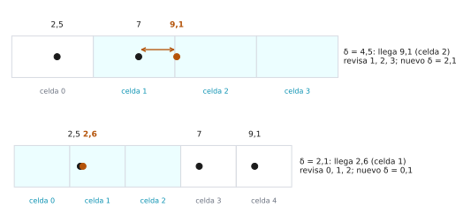

# Ejercicio 10. Par más cercano en una dimensión

Dificultad: ★★ · Código: [`ejercicio-10.py`](ejercicio-10.py)

---

## Enunciado

> Demuestra $\Omega(n \log n)$ para el par más cercano en una dimensión en árboles de decisión algebraicos, por reducción desde la distinción de elementos. Después di qué algoritmo de la conferencia 2 rompe la cota, en qué modelo, y adáptalo a una dimensión.

## Qué se pide

1. Demostrar que el par más cercano en una dimensión requiere $\Omega(n \log n)$ en el modelo de árboles de decisión algebraicos, **reduciendo** desde la distinción de elementos.
2. Identificar el algoritmo de la Conferencia 2 que rompe la cota y explicar en qué modelo lo hace.
3. Adaptar ese algoritmo a una dimensión y analizar su corrección y su costo esperado.

**Mapa.** El ejercicio cuenta una historia en tres pasos que se enlazan. (1) Se demuestra una cota inferior $\Omega(n \log n)$, y se hace por **reducción**: si el par más cercano fuera más rápido, la distinción de elementos también lo sería, y para la distinción ya se conoce la cota. (2) Hay un algoritmo de la Conferencia 2 que resuelve el par más cercano en tiempo esperado $O(n)$, lo que parece contradecir la cota. No la contradice, porque la cota vale en un modelo de cómputo y el algoritmo usa operaciones que ese modelo no permite. (3) Se adapta ese algoritmo a una dimensión y se prueba su corrección y su costo.

## Preliminares

**Entrada.** $n$ números reales $x_1, \dots, x_n$, vistos como puntos de una recta.

**Par más cercano.** Hallar $i \ne j$ que minimicen $|x_i - x_j|$; la distancia mínima es

$$\delta^\ast = \min_{i \ne j} |x_i - x_j|.$$

**Distinción de elementos.** Decidir «sí» si hay dos $x_i$ iguales y «no» si todos son distintos.

**Ejemplo.** Con $(7,3,7,1)$: la distinción responde «sí» y $\delta^\ast = 0$. Con $(7,3,5,1)$: responde «no» y $\delta^\ast = 2$.

**El modelo** (Conferencia 2, §8). Un **árbol de decisión algebraico** tiene en cada nodo interno un polinomio $p(x_1, \dots, x_n)$ de grado acotado; se evalúa su signo y hay tres ramas ($p < 0$, $p = 0$, $p > 0$). Cada hoja da una respuesta y el costo es la **profundidad** (el número de pruebas en el peor caso). El modelo capta comparar, sumar, restar, multiplicar y medir distancias; **no** tiene parte entera, ni memoria con índices calculados, ni azar. Si solo se permiten polinomios $x_i - x_j$, es el árbol de comparaciones de la Conferencia 5.

**Teorema (Ben-Or, 1983; Conferencia 2, §8).** Todo árbol de decisión algebraico que resuelva la distinción de $n$ elementos tiene profundidad $\Omega(n \log n)$.

La Conferencia 2 **cita** este teorema sin demostrarlo: su prueba acota el número de componentes conexas del conjunto de entradas «todos distintos» mediante un teorema de Milnor y Thom. En «De dónde sale $\Omega(n \log n)$ (pruebas lineales)» se da la idea completa para pruebas **lineales**, que muestra de dónde sale la cota.

---

## De dónde sale $\Omega(n \log n)$ (pruebas lineales)

La reducción de la sección siguiente necesita una cota para la distinción de elementos. Esta sección explica de dónde sale en el caso más simple, el de las pruebas lineales. La idea es contar hojas: cada uno de los $n!$ órdenes de los números necesita su propia hoja, y un árbol de profundidad $d$ tiene a lo sumo $3^d$ hojas.

**Proposición 1.** Todo árbol de decisión con pruebas lineales (signo de $a_1x_1 + \dots + a_nx_n + b$) que resuelva la distinción de $n$ elementos tiene al menos $n!$ hojas y profundidad $d \ge \log_3 n! = \Omega(n \log n)$.

**Demostración.**

**Paso 1. Las hojas son convexas.** Cada respuesta a una prueba lineal impone un semiespacio abierto ($<$ o $>$) o un hiperplano ($=$). El conjunto de entradas que llega a una hoja es la intersección de los conjuntos impuestos en su camino: es **convexo**.

**Paso 2. Dos órdenes distintos.** Hay $n!$ órdenes posibles de $n$ números distintos. Sean $P$ y $Q$ dos entradas con órdenes distintos. Entonces existen índices $i, j$ con $x_i < x_j$ en $P$ y $x_i > x_j$ en $Q$.

**Paso 3. El segmento cruza un caso con repetidos.** La función $t \mapsto (x_i - x_j)\big((1-t)P + tQ\big)$ es continua, negativa en $t = 0$ y positiva en $t = 1$. Por el teorema del valor intermedio se anula en algún $t^\ast \in (0,1)$: en ese punto del segmento $x_i = x_j$ y la respuesta correcta es «sí».

**Ejemplo ($n = 2$):** $P = (1,5)$, $Q = (5,1)$; el punto medio $M = (3,3)$ tiene repetidos.

**Paso 4.** En $P$ y $Q$ la respuesta correcta es «no». Si cayeran en la misma hoja, esa hoja (convexa) contendría todo el segmento, incluido el punto con repetidos, y una hoja da una sola respuesta. Contradicción.

**Paso 5.** Entonces cada orden necesita su propia hoja: al menos $n!$ hojas.

**Paso 6.** Un árbol con 3 ramas por nodo y profundidad $d$ tiene a lo sumo $3^d$ hojas, luego $3^d \ge n!$ y $d \ge \log_3 n!$.

**Paso 7.** La mitad de los factores de $n!$ valen al menos $n/2$, así que $n! \ge (n/2)^{n/2}$ y

$$d \ge \log_3 n! \ge \frac{n}{2}\log_3\frac{n}{2} = \Omega(n \log n). \qquad\blacksquare$$

**Ejemplo numérico** ($n = 4$). Hay $4! = 24$ órdenes y $3^2 = 9 < 24 \le 27 = 3^3$, así que hacen falta al menos $3$ preguntas.

**Nota.** Con polinomios de grado fijo cualquiera, una hoja puede tener varias componentes conexas y el argumento de convexidad ya no sirve. El teorema de Milnor y Thom (que aquí se cita) acota cuántas componentes puede tener una hoja, y con esa cota Ben-Or obtiene de nuevo $\Omega(n \log n)$.

---

## La reducción

Con la cota de la distinción de elementos en la mano, falta pasarla al par más cercano.

**Teorema 1.** El par más cercano en una dimensión requiere $\Omega(n \log n)$ en árboles de decisión algebraicos.

**Construcción.** Si existiera un árbol de profundidad $T(n)$ para el par más cercano, se obtendría uno de profundidad $T(n) + 1$ para la distinción de elementos:

**Paso 1.** Dada la entrada $x_1, \dots, x_n$ de la distinción, se usan **los mismos números** como puntos de la recta. No se hace ningún cálculo ni ninguna prueba de signo. (En la Conferencia 2, §8, la entrada es $x_i \mapsto (x_i, 0)$ en el plano, que es lo mismo.)

**Paso 2.** Se ejecuta el árbol del par más cercano; cada hoja da un par de índices $(i, j)$, con $\delta^\ast = |x_i - x_j|$.

**Paso 3.** Se hace **una prueba más**: el signo de $x_i - x_j$. Si es $0$, la respuesta es «sí»; si no, «no».

**Corrección.**

**Paso 4.** Si hay dos números iguales, su distancia es $0$, la mínima también, y el par devuelto tiene $x_i = x_j$.

**Paso 5.** Si todos son distintos, todas las distancias son positivas, y la del par devuelto también.

Por tanto

$$\delta^\ast = 0 \iff \text{hay repetidos}.$$

**Costo.** El paso 1 no cuesta nada y el paso 3 añade una prueba:

$$T_{\text{distinción}}(n) \le T(n) + 1.$$

**Conclusión.** Por «De dónde sale $\Omega(n \log n)$» (o el teorema de Ben-Or), $T_{\text{distinción}}(n) = \Omega(n \log n)$, luego $T(n) \ge \Omega(n\log n) - 1$ y

$$T(n) = \Omega(n \log n). \qquad\blacksquare$$

**Observación.** Aunque la reducción añadiera del orden de $n$ pruebas, la conclusión sería la misma, pues $n\log n - n$ sigue siendo del orden de $n \log n$. Lo que importa es que la reducción sea barata.

**Ejemplo.** Con $(7,3,7,1)$ el árbol devuelve el par de posiciones $1$ y $3$ con $\delta^\ast = 0$ y se responde «sí»; con $(7,3,5,1)$ devuelve $\delta^\ast = 2$ y se responde «no».

**Cómo se lee una reducción** (Conferencia 2, §8). En una dirección, un algoritmo bueno para el problema destino da uno bueno para el origen (diseño); en la otra, una cota mínima del origen da una cota mínima del destino, que es como se usó aquí.

---

## El algoritmo de la Conferencia 2 que rompe la cota

La cota que se acaba de probar parece cerrar el problema: no se puede hacer mejor que $n \log n$. Sin embargo, la Conferencia 2 tiene un algoritmo de tiempo esperado $O(n)$ para el mismo problema. Esta sección explica por qué no hay contradicción.

**Cuál es.** El algoritmo incremental aleatorizado de la rejilla para el par más cercano (Rabin, 1976; versión de Kleinberg y Tardos, §13.7), en la Conferencia 2, §9.

**Cómo rompe la cota.** En el plano tiene tiempo esperado $O(n)$, menos que $\Omega(n\log n)$. No hay contradicción, porque una cota mínima vale **para un modelo** y el algoritmo usa tres cosas que el árbol algebraico no tiene:

| el algoritmo usa | el modelo no tiene |
|---|---|
| Parte entera: $k = \lfloor x/\delta \rfloor$ | solo se pregunta el signo de un polinomio |
| Tabla hash indexada por la celda $k$ | no hay memoria con índices calculados |
| Azar para permutar los puntos | el árbol es determinista |

La cota dice «en el modelo algebraico, $\Omega(n\log n)$», y el algoritmo sale de ese modelo. Dentro del modelo, ordenar y mirar los vecinos ($O(n\log n)$) es óptimo (Conferencia 2, §10: toda cota mínima viene con su modelo).

---

## Adaptación a una dimensión

Ahora se construye ese algoritmo en el caso más sencillo, la recta. Todo lo que la cota prohíbe en el modelo algebraico (parte entera, tabla hash, azar) aparece aquí.

**Idea.** Se mantiene $\delta$, la mejor distancia entre los puntos ya insertados. La recta se corta en celdas $[k\delta, (k+1)\delta)$. Como $\delta$ es la mínima distancia, **cada celda tiene a lo sumo un punto**: dos puntos en la misma celda estarían a distancia menor que $\delta$.

**Observación clave.** Un punto nuevo $p$ en la celda $k$ solo puede mejorar $\delta$ si hay un punto a distancia menor que $\delta$, y ese punto está en la celda $k-1$, $k$ o $k+1$. Basta mirar **3 celdas** (en el plano, con celdas de lado $\delta/2$, son $25$).

```python
def construir(pts, delta):
    return {floor(q / delta): q for q in pts}

def par_mas_cercano_1d(xs):
    puntos = xs[:]
    random.shuffle(puntos)                    # orden aleatorio
    delta = abs(puntos[0] - puntos[1])
    if delta == 0:
        return 0
    tabla = construir(puntos[:2], delta)      # celda k -> punto
    for i in range(2, len(puntos)):
        p = puntos[i]
        k = floor(p / delta)
        mejor = delta
        for c in (k - 1, k, k + 1):           # 3 celdas
            if c in tabla:
                mejor = min(mejor, abs(p - tabla[c]))
        if mejor < delta:
            delta = mejor
            if delta == 0:
                return 0
            tabla = construir(puntos[:i + 1], delta)   # reconstruir
        else:
            tabla[k] = p
    return delta
```

(La versión de [`ejercicio-10.py`](ejercicio-10.py) es la misma, con parámetros para fijar la semilla o desactivar el barajado, y con un contador del trabajo.)

**Ejemplo.** Orden de inserción $7,\ 2{,}5,\ 9{,}1,\ 2{,}6$:

| paso | punto | $\delta$ antes | qué pasa | $\delta$ después |
|---|---|---|---|---|
| 1 | $7$ y $2{,}5$ | | $\delta = 4{,}5$ | $4{,}5$ |
| 2 | $9{,}1$ | $4{,}5$ | celda $2$; revisa $1,2,3$; encuentra el $7$ a distancia $2{,}1$; reconstruye | $2{,}1$ |
| 3 | $2{,}6$ | $2{,}1$ | celda $1$; revisa $0,1,2$; encuentra el $2{,}5$ a distancia $0{,}1$; reconstruye | $0{,}1$ |

<picture>
  <source media="(prefers-color-scheme: dark)" srcset="figuras/ejercicio-10-rejilla-oscuro.svg">
  
</picture>

**Figura 1.** Los pasos 2 y 3 del ejemplo. Las celdas tienen ancho $\delta$, y las tres que se revisan alrededor del punto nuevo están sombreadas. En el paso 2 el $9{,}1$ cae en la celda $2$ y encuentra el $7$ en la celda $1$. En el paso 3, ya reconstruida la tabla con $\delta = 2{,}1$, el $2{,}6$ cae en la celda $1$, la misma del $2{,}5$.

### Corrección

El ejemplo muestra que el algoritmo mejora $\delta$ cuando encuentra un punto cercano en las tres celdas. Falta probar que nunca se le pasa un punto más cercano, y para eso se usa un invariante.

**Invariante.** Tras insertar los primeros $i$ puntos, $\delta$ es la distancia mínima entre ellos y la tabla guarda cada punto en su celda, a lo sumo uno por celda.

**Teorema 2.** El algoritmo devuelve la distancia mínima.

**Demostración.**

**Paso 1.** Al principio, con 2 puntos, $\delta$ es su distancia. Si $\delta = 0$ se devuelve $0$, que es correcto.

**Paso 2.** Se inserta $p$. Si existe un punto $q$ ya insertado con $|p - q| < \delta$, entonces $q$ está en la celda $k-1$, $k$ o $k+1$ (sus coordenadas difieren en menos de $\delta$, es decir, en menos de una celda), así que el algoritmo lo ve y actualiza $\delta$.

**Paso 3.** Si no existe tal $q$, $\delta$ sigue siendo la mínima y $p$ está solo en su celda (si no, habría un punto a distancia menor que $\delta$). Se guarda en la tabla.

**Paso 4.** Si $\delta$ baja, la tabla se reconstruye con el nuevo ancho y la propiedad de un punto por celda vale con el nuevo $\delta$. $\blacksquare$

### Costo esperado $O(n)$

Cada punto cuesta $O(1)$, salvo cuando $\delta$ baja y hay que reconstruir la tabla. Todo el análisis consiste en ver que eso ocurre pocas veces cuando el orden es aleatorio.

**Teorema 3.** Con el orden aleatorio, el tiempo esperado es $O(n)$ (suponiendo $O(1)$ por operación de la tabla hash).

**Demostración (análisis hacia atrás, Conferencia 2, §9).**

**Paso 1.** Cada punto cuesta $O(1)$ (3 consultas y una inserción).

**Paso 2.** Se reconstruye en el paso $i$ solo si $\delta$ baja, es decir, si el punto $i$ pertenece al par más cercano de los primeros $i$.

**Paso 3.** Se fija el *conjunto* de los primeros $i$ puntos y se pregunta quién fue el último. Como el orden es una permutación uniforme, el último es uniforme entre los $i$. El par más cercano tiene $2$ puntos (si hay empates, $\delta$ baja solo si el último está en todos los pares mínimos, con probabilidad aún menor):

$$P(\text{reconstruir en el paso } i) \le \frac{2}{i}.$$

**Paso 4.** Reconstruir cuesta $i$ inserciones, luego el costo esperado de reconstruir en el paso $i$ es a lo sumo $\frac{2}{i}\cdot i = 2$.

**Paso 5.** Sumando sobre los $n$ pasos, las reconstrucciones cuestan $O(n)$ en esperanza, y con el trabajo fijo por punto el total es $O(n)$. $\blacksquare$

El número esperado de reconstrucciones es a lo sumo $\sum_{i}2/i \approx 2\ln n$.

**El orden aleatorio importa.** Si los puntos llegan en un orden adversario en que cada punto nuevo forma un par más cercano que el anterior (por ejemplo $1 + \frac1i$ para $i = 1, 2, \dots$, con gaps $\frac1i - \frac1{i+1}$ decrecientes), $\delta$ baja en cada paso: hay una reconstrucción por paso y el total es $1 + 2 + \dots + n = \Theta(n^2)$.

---

## Verificación con código

El archivo [`ejercicio-10.py`](ejercicio-10.py) comprueba: (a) el conteo de hojas y profundidad mínima; (b) el argumento del segmento sobre todos los pares de órdenes distintos; (c) la reducción; (d) la corrección del algoritmo de la rejilla contra ordenar y mirar vecinos; (e) el trabajo con orden aleatorio y adversario.

```
Hojas mínimas (n!) y profundidad mínima con tres ramas por nodo
  n         n!  menor d con 3^d >= n!
  2          2                      1
  3          6                      2
  4         24                      3
  5        120                      5
  8     40,320                     10
 10  3,628,800                     14

Pares de entradas con órdenes distintos (n = 2, 3, 4): 584;
  su segmento pasa por una entrada con repetidos en 584

Reducción: distancia mínima = 0  <=>  hay repetidos
  [7, 3, 7, 1]: distancia mínima = 0, repetidos = True
  [7, 3, 5, 1]: distancia mínima = 2, repetidos = False

Corrección del algoritmo de la rejilla contra el ordenamiento
  3000 entradas aleatorias, sin discrepancias

Ejemplo del texto: orden de inserción 7, 2.5, 9.1, 2.6
  tras 7 y 2.5: delta = 4.5
  punto 9.1: celda 2, se revisan [1, 2, 3]
    mejora: delta = 2.1
  punto 2.6: celda 1, se revisan [0, 1, 2]
    mejora: delta = 0.1
```

Trabajo por punto en la tabla y reconstrucciones, con el orden aleatorio y con el orden adversario (salida del programa):

| $n$ | azar: trabajo/$n$ | azar: reconstr. | $2\ln n$ | adversario: trabajo/$n$ | adversario: reconstr. | adversario barajado: trabajo/$n$ | adversario barajado: reconstr. |
|---|---|---|---|---|---|---|---|
| 200 | 6,0 | 9 | 10,6 | 103,5 | 198 | 5,4 | 9 |
| 1000 | 7,7 | 15 | 13,8 | 503,5 | 998 | 5,0 | 10 |
| 3000 | 5,5 | 12 | 16,0 | 1503,5 | 2998 | 6,1 | 11 |

Con orden aleatorio, el trabajo por punto se queda en unas $5$–$8$ operaciones y las reconstrucciones (unas $9$–$15$) son del orden de $2\ln n$. El Teorema 3 acota su **esperanza**, y cada fila es el promedio de solo $5$ corridas, así que una fila puede pasar la cota, como la de $n = 1000$. Con el orden adversario hay una reconstrucción por punto ($198$, $998$, $2998$) y el trabajo por punto crece como $n/2$. Los mismos puntos adversarios, **barajados**, vuelven a costar $\approx 5$–$6$ por punto.

## Resumen de resultados

1. **Modelo:** árbol de decisión algebraico; cada nodo prueba el signo de un polinomio y el costo es la profundidad.
2. **Cota de la distinción de elementos:** $\Omega(n\log n)$ (Ben-Or). Con pruebas lineales: hojas convexas, $n!$ órdenes, $3^d \ge n!$.
3. **Reducción:** los números son los puntos y $\delta^\ast = 0 \iff$ hay repetidos; añade una prueba de signo, luego el par más cercano es $\Omega(n\log n)$.
4. **Algoritmo que rompe la cota:** la rejilla aleatorizada de la Conferencia 2, §9; usa parte entera, tabla hash y azar, que el modelo no tiene.
5. **En una dimensión:** celdas de ancho $\delta$, un punto por celda, 3 celdas por consulta, reconstrucción cuando $\delta$ baja; probabilidad $\le 2/i$ por costo $i$ da $O(n)$ esperado. Con orden adversario, $\Theta(n^2)$.

## Referencias

- Conferencia 2, §8: árboles de decisión algebraicos, teorema de Ben-Or (citado) y la reducción $x_i \mapsto (x_i, 0)$.
- Conferencia 2, §9: algoritmo incremental aleatorizado, invariante «una por celda» y análisis hacia atrás.
- Conferencia 5, Lema 1: un árbol binario de altura $h$ tiene a lo sumo $2^h$ hojas (aquí se usa su análogo con 3 ramas, $3^d$).
