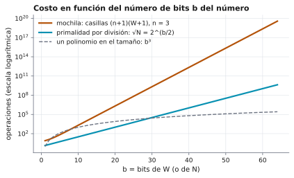

# Ejercicio 11. La mochila entera y el tamaño de la entrada

Dificultad: ★★ · Código: [`ejercicio-11.py`](ejercicio-11.py)

---

## Enunciado

> La mochila entera se resuelve con programación dinámica en $O(nW)$, donde $W$ es la capacidad. Mide el tamaño de la entrada en bits, como en la sección 8 de la conferencia 1. ¿Es polinomial ese algoritmo? ¿En qué se parece a la primalidad por división?

## Qué se pide

1. Presentar el algoritmo de programación dinámica, demostrar su correctitud y su costo $\Theta(nW)$.
2. Medir el tamaño de la entrada **en bits** y decidir si el algoritmo es polinomial en ese tamaño.
3. Comparar con la primalidad por división (Conferencia 1, §8).

**Mapa.** El ejercicio tiene una sola idea que se mira desde tres lados. El algoritmo de programación dinámica parece rápido, porque su costo $O(nW)$ es un producto de dos números. Pero $W$ aparece en la entrada escrito en binario, con solo $\log_2 W$ bits, y el costo es proporcional a $W$ y no a $\log_2 W$. Por eso el algoritmo no es polinomial en el tamaño real de la entrada. La primalidad por división tiene exactamente el mismo defecto.

## Preliminares

**El problema.** Hay $n$ objetos con pesos $p_i$ y valores $v_i$ (enteros positivos) y una capacidad $W$ (entero positivo). Se busca el mayor valor total de un subconjunto de objetos cuyo peso total sea a lo sumo $W$; cada objeto se toma entero o no se toma.

**Costo.** Se cuentan operaciones sobre palabras (modelo word RAM, Conferencia 1), con una palabra suficiente para guardar cada número de la entrada.

**Tamaño de la entrada** (Conferencia 1, §8). Un algoritmo es *polinomial* si su costo está acotado por un polinomio en el **tamaño de la entrada**, que es la cantidad de bits que ocupa escrita. Un número $N$ en binario ocupa $\lceil \log_2 (N+1) \rceil$ bits.

**Ejemplo.** Con $n = 3$ y $W = 5$:

| objeto | peso | valor |
|---|---|---|
| 1 | 2 | 3 |
| 2 | 3 | 4 |
| 3 | 4 | 5 |

La respuesta es $7$ (los objetos 1 y 2, de peso total $2 + 3 = 5$).

---

## El algoritmo y su costo en función de $W$

Primero se presenta el algoritmo y se calcula su costo tal como se suele escribir, en función de $n$ y $W$. La sección siguiente cambia la unidad de medida.

Se define $\text{dp}[i][w]$ como el mayor valor que se logra usando solo los primeros $i$ objetos con capacidad $w$.

- **Caso base:** $\text{dp}[0][w] = 0$.
- Si $p_i > w$ (no cabe): $\text{dp}[i][w] = \text{dp}[i-1][w]$.
- Si $p_i \le w$: $\text{dp}[i][w] = \max\bigl(\text{dp}[i-1][w],\ v_i + \text{dp}[i-1][w - p_i]\bigr)$.

```python
def mochila(pesos, valores, W):
    n = len(pesos)
    dp = [[0] * (W + 1) for _ in range(n + 1)]
    for i in range(1, n + 1):
        for w in range(W + 1):
            dp[i][w] = dp[i - 1][w]
            if pesos[i - 1] <= w:
                dp[i][w] = max(dp[i][w],
                               valores[i - 1] + dp[i - 1][w - pesos[i - 1]])
    return dp[n][W]
```

**Tabla del ejemplo:**

| $i \backslash w$ | 0 | 1 | 2 | 3 | 4 | 5 |
|---|---|---|---|---|---|---|
| 0 | 0 | 0 | 0 | 0 | 0 | 0 |
| 1 (peso 2, valor 3) | 0 | 0 | 3 | 3 | 3 | 3 |
| 2 (peso 3, valor 4) | 0 | 0 | 3 | 4 | 4 | 7 |
| 3 (peso 4, valor 5) | 0 | 0 | 3 | 4 | 5 | 7 |

Por ejemplo, $\text{dp}[2][5] = \max(3,\ 4 + \text{dp}[1][2]) = \max(3,\ 4 + 3) = 7$.

**Lema 1 (correctitud).** Para todo $0 \le i \le n$ y $0 \le w \le W$, $\text{dp}[i][w]$ es el máximo valor de un subconjunto de $\{1, \dots, i\}$ con peso total $\le w$.

**Demostración (inducción sobre $i$).**

**Base ($i = 0$).** Solo existe el subconjunto vacío, de valor $0$.

**Paso inductivo.** Se supone el lema para $i-1$. Un subconjunto óptimo $S \subseteq \{1,\dots,i\}$ con peso $\le w$ cumple una de dos:

- **$i \notin S$.** Entonces $S$ es un subconjunto de $\{1,\dots,i-1\}$ con peso $\le w$; su valor máximo es $\text{dp}[i-1][w]$ por hipótesis.
- **$i \in S$ (solo posible si $p_i \le w$).** Entonces $S \setminus \{i\}$ es un subconjunto de $\{1,\dots,i-1\}$ con peso $\le w - p_i$, y el mejor valor es $v_i + \text{dp}[i-1][w-p_i]$ por hipótesis.

Así el valor óptimo es a lo sumo el máximo de los dos casos (o solo el primero si $p_i > w$), que es lo que calcula la recurrencia. Al revés, los dos valores se alcanzan: $\text{dp}[i-1][w]$ con un subconjunto de $\{1,\dots,i-1\}$ de peso $\le w$, y, si $p_i \le w$, $v_i + \text{dp}[i-1][w-p_i]$ agregando $i$ a un subconjunto de peso $\le w - p_i$, con lo que el peso queda $\le w$. Entonces la recurrencia da exactamente el valor óptimo. $\blacksquare$

**Teorema 1 (costo).** El algoritmo cuesta $\Theta(nW)$ en **toda** entrada.

**Demostración.**

**Paso 1.** La tabla tiene $(n+1)$ filas y $(W+1)$ columnas.

**Paso 2.** El algoritmo llena **todas** las casillas, y cada una cuesta $O(1)$ (una comparación, una suma y una lectura), sin depender de los datos.

**Paso 3.** El total es $\Theta\bigl((n+1)(W+1)\bigr) = \Theta(nW)$. $\blacksquare$

Con $n = 3$, $W = 5$ son $4 \cdot 6 = 24$ casillas. Con los mismos $3$ objetos y $W = 10^6$ son $4\cdot 1\,000\,001 = 4\,000\,004$ casillas: la tabla creció más de $150\,000$ veces aunque la entrada casi no cambió.

---

## El tamaño de la entrada en bits

El costo $\Theta(nW)$ está medido en $W$, que es un valor. Para decidir si es polinomial hay que medirlo en el tamaño de la entrada, que es la cantidad de bits. Esta sección calcula ese tamaño.

**Paso 1.** La entrada tiene $2n$ números para pesos y valores, más $W$. Si cada número de los objetos ocupa a lo sumo $c$ bits y $W$ ocupa $b = \lceil \log_2(W+1) \rceil$ bits, el tamaño es

$$s \le 2nc + b.$$

**Paso 2.** Cada bit adicional duplica el máximo valor que se puede escribir: $7 = 111_2$ tiene $3$ bits y $15 = 1111_2$ tiene $4$, con $15 = 2\cdot 7 + 1$. Por eso, si $W$ tiene $b$ bits,

$$2^{b-1} \le W < 2^b.$$

| número | binario | bits |
|---|---|---|
| 5 | 101 | 3 |
| 1000 | 1111101000 | 10 |
| 1 000 000 | | 20 |

**Observación.** $W$ aparece en el tamaño de la entrada como $b = \log_2 W$ bits, no como $W$.

---

## ¿Es polinomial?

Con el costo en función de $W$ y el tamaño en función de $\log_2 W$, ya se puede comparar los dos y responder la pregunta del enunciado.

**Definición** (Conferencia 1, §8). Un algoritmo es *pseudopolinomial* si su costo es polinomial en el **valor** de los números de la entrada, pero no en su cantidad de bits.

**Teorema 2.** El algoritmo de programación dinámica no es polinomial en el tamaño de la entrada; es pseudopolinomial.

**Demostración.**

**Paso 1.** Se fija $n = 3$ objetos de peso y valor $1$ (cada uno ocupa $1$ bit) y se toma $W$ con $b$ bits, $W \ge 2^{b-1}$. El tamaño de la entrada es $s \le 6 + b \le 2b$ para $b \ge 6$.

**Paso 2.** Por el Teorema 1, el costo es $\Theta(nW) = \Theta(W) \ge c'\,2^{b-1}$ para una constante $c' > 0$.

**Paso 3.** Si existiera un polinomio $q$ con costo $\le q(s)$ para toda entrada, se tendría $c'\,2^{b-1} \le q(2b)$ para todo $b \ge 6$. Pero $2^b$ crece más rápido que cualquier polinomio en $b$: contradicción para $b$ grande. $\blacksquare$

**Tabla con $n = 3$** (código; $W = 2^{b-1}$, el menor número de $b$ bits):

| bits de $W$ | $W$ | casillas $(n+1)(W+1)$ |
|---|---|---|
| 3 | 4 | 20 |
| 10 | 512 | $2{,}05\cdot10^{3}$ |
| 20 | 524 288 | $2{,}1\cdot10^{6}$ |
| 30 | 536 870 912 | $2{,}15\cdot10^{9}$ |
| 40 | $5{,}5\cdot10^{11}$ | $2{,}2\cdot10^{12}$ |
| 50 | $5{,}6\cdot10^{14}$ | $2{,}25\cdot10^{15}$ |
| 64 | $9{,}2\cdot10^{18}$ | $3{,}69\cdot10^{19}$ |

Con los tres objetos del Paso 1 y $W$ de $50$ bits, la entrada ocupa menos de $200$ bits y la tabla tiene unas $10^{15}$ casillas: a $10^9$ casillas por segundo, son más de $10$ días solo para llenarla.

**Cuándo sí es rápido.** Si $W \le n^2$, entonces $nW \le n^3$ y el algoritmo es polinomial. El problema aparece solo cuando $W$ puede ser exponencialmente grande respecto a su cantidad de bits.

**El papel de la codificación.** Si $W$ se escribiera en **unario** (por ejemplo $5$ como `11111`), el tamaño de $W$ sería $W$ símbolos. Con $n \le s$ y $W \le s$:

$$nW \le s \cdot s = s^2,$$

que es polinomial en $s$. El algoritmo es el mismo; lo que cambia es cómo se mide la entrada. Con $W = 1000$ el binario ocupa $10$ símbolos y el unario $1000$; con $W = 2^{40}$ el unario ocuparía unos $10^{12}$ símbolos, del orden de un terabyte. Por eso la Conferencia 1 mide la entrada en binario: es la medida que no se infla artificialmente.

**Observación.** Esto no contradice nada conocido: la versión de decisión de la mochila («¿hay un subconjunto de peso $\le W$ y valor $\ge V$?») es NP-completa (Tema 3). Existe un algoritmo pseudopolinomial, pero no se conoce uno polinomial en el tamaño en bits.

---

## El parecido con la primalidad por división

La última pregunta del enunciado es en qué se parece la mochila a un algoritmo que parece muy distinto. La respuesta es que ambos tienen la misma estructura de costo, y se ve mejor con el algoritmo más sencillo de los dos.

**El algoritmo.** Para saber si $N$ es primo se prueba dividir por $2, 3, \dots, \lfloor \sqrt N \rfloor$.

**Paso 1.** Hace unas $\sqrt N$ divisiones: polinomial en el **valor** $N$.

**Paso 2.** El tamaño de la entrada es $b \approx \log_2 N$ bits, y $\sqrt N \approx 2^{b/2}$: exponencial en $b$.

**Paso 3.** Con $N$ de $1024$ bits son $2^{512} \approx 1{,}3\cdot 10^{154}$ divisiones, inalcanzable en cualquier tiempo razonable (Conferencia 1, §8).

| bits de $N$ | divisiones $\approx 2^{b/2}$ |
|---|---|
| 32 | $2^{16} = 6{,}55\cdot10^{4}$ |
| 64 | $2^{32} = 4{,}29\cdot10^{9}$ |
| 128 | $2^{64} = 1{,}84\cdot10^{19}$ |
| 256 | $2^{128} = 3{,}4\cdot10^{38}$ |
| 1024 | $2^{512} = 1{,}34\cdot10^{154}$ |

**Comparación:**

| | primalidad por división | mochila con tabla |
|---|---|---|
| número que engaña | $N$ | $W$ |
| costo en el valor | $\sqrt N$ | $nW$ |
| bits del número | $b \approx \log_2 N$ | $b \approx \log_2 W$ |
| costo en bits | $2^{b/2}$ | $n\cdot 2^{b}$ |
| ¿polinomial en bits? | no | no |
| clasificación | pseudopolinomial | pseudopolinomial |

**El parecido.** En ambos casos el algoritmo hace un trabajo por cada unidad del valor de un número de la entrada, y ese valor es exponencial en su número de bits: parece un ciclo sencillo y es exponencial en el tamaño real.

<picture>
  <source media="(prefers-color-scheme: dark)" srcset="figuras/ejercicio-11-bits-oscuro.svg">
  
</picture>

**Figura 1.** El costo de los dos algoritmos en función de los bits $b$ del número, en escala logarítmica: las casillas de la tabla de la mochila con $n = 3$ y $W = 2^{b-1}$, y las divisiones de la primalidad, $\sqrt N = 2^{b/2}$. Las dos son rectas, es decir, exponenciales en $b$. Un polinomio como $b^3$ se aplana.

**La diferencia.** La primalidad **sí** tiene algoritmos polinomiales en bits: Miller–Rabin (aleatorizado) y, desde 2002, el de Agrawal, Kayal y Saxena (determinista). Para la mochila no se conoce ninguno.

---

## Verificación con código

El archivo [`ejercicio-11.py`](ejercicio-11.py) implementa la tabla, la compara con la fuerza bruta (todos los subconjuntos) en instancias aleatorias y calcula los tamaños.

```
Ejemplo: n = 3, W = 5, respuesta = 7
  i = 0: [0, 0, 0, 0, 0, 0]
  i = 1: [0, 0, 3, 3, 3, 3]
  i = 2: [0, 0, 3, 4, 4, 7]
  i = 3: [0, 0, 3, 4, 5, 7]
2000 instancias aleatorias: la tabla coincide con la fuerza bruta
```

Escala de la tabla si $W$ se escribiera en unario (tamaño $\approx W$):

| $W$ | símbolos en binario | símbolos en unario | casillas con $n = 3$ |
|---|---|---|---|
| 10 | 4 | 10 | 44 |
| 1000 | 10 | 1000 | 4004 |
| 1 000 000 | 20 | 1 000 000 | 4 000 004 |

La tabla de «El algoritmo y su costo en función de $W$» coincide con la salida, y en las $2000$ instancias aleatorias el algoritmo da el mismo valor que la fuerza bruta. Las tablas de «¿Es polinomial?» y «El parecido con la primalidad por división» son las que imprime el archivo.

## Resumen de resultados

1. **Algoritmo:** tabla $\text{dp}[i][w]$ de $(n+1)\times(W+1)$ casillas, cada una en $O(1)$; correcto por inducción sobre $i$ y de costo $\Theta(nW)$ en toda entrada.
2. **Tamaño de la entrada:** $2n$ números más $W$, y $W$ ocupa $b = \lceil\log_2(W+1)\rceil$ bits, con $W \approx 2^b$.
3. **¿Polinomial?** No: el costo es $n\cdot 2^b$, exponencial en los bits de $W$. Es **pseudopolinomial**.
4. **Codificación:** en unario sería polinomial; por eso el tamaño se mide en binario.
5. **Parecido con la primalidad por división:** ambos hacen un trabajo por unidad del valor ($\sqrt N$ divisiones, $nW$ casillas), exponencial en los bits. La primalidad sí es polinomial con otros algoritmos; la mochila no se sabe (es NP-completa).

## Referencias

- Conferencia 1, §8: tamaño de la entrada en bits, polinomial vs. pseudopolinomial, primalidad por división.
